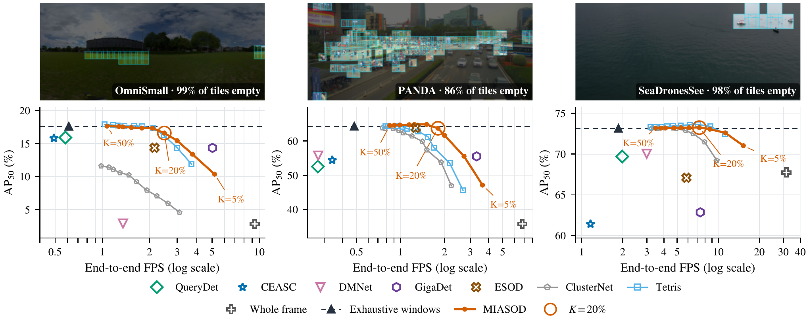

<div align="center">

# MIASOD

**Less Compute at Native Scale: Motion-Informed Acceleration of Small Object Detection in Ultra-High-Resolution Video**

</div>

<p align="center">
  
</p>

## Installation

```bash
git clone https://github.com/Xin-Shu/MIASOD.git && cd MIASOD
conda create -n miasod python=3.9 -y && conda activate miasod
pip install -r requirements.txt

# Bit-cost decoder: FFmpeg (H.264 only) with the bit-cost patch, built into one self-contained library.
# Needs git, gcc and make (nasm optional).
bash script/bitcost/build.sh          # -> script/bitcost/build/libmia_bc.so
```

DINO-R50 also needs MMDetection 3.3 (`mmdet==3.3.0`, `mmengine`, `mmcv>=2.0,<2.2`).

## Running MIASOD

```bash
python script/miasod.py -i video.mp4
```

This writes `det.txt` next to the video, one line per box: `frame,-1,x,y,w,h,score,-1,-1,-1`. The three models are
read from `weights/yolov11l_coarse1024.pt`, `weights/yolov11l_window512.pt` and `weights/fd_gate.pt` (see
[Training](#training)). The video must be H.264 with I- and P-frames only; otherwise re-encode it:

```bash
ffmpeg -i input.mp4 -c:v libx264 -preset medium -crf 22 -g 30 -bf 0 -pix_fmt yuv420p video.mp4
```

### Options

| option | default | meaning |
|---|---|---|
| `-i`, `--input` | (required) | one or more videos; each is one clip |
| `-o`, `--output` | `{dir}/det.txt` | detection file; `{dir}` and `{stem}` are the video's folder and name |
| `--summary` | off | also write `det_summary.json` (FPS, milliseconds per stage) |
| `--mode` | `window` | `window` or `crop` |
| `--keep` | `0.2` | budget K, fraction of candidate regions detected; `1` = exhaustive windows |
| `--cues` | `coarse fd bc` | cues fused by the rank mean |
| `--window-size`, `--window-overlap` | `512`, `128` | window grid (e.g. `1024`, `256`) |
| `--coarse-weights` | `weights/yolov11l_coarse1024.pt` | coarse-pass detector |
| `--window-weights` | `weights/yolov11l_window512.pt` | window detector |
| `--fd-weights` | `weights/fd_gate.pt` | FD network |
| `--window-detector`, `--global-detector` | YOLOv11-L | detector configs, e.g. DINO-R50 below |
| `--max-det` | `300` | boxes per frame (PANDA: `2000`, with `--detector-opt window.max_det=200`) |

DINO-R50: `--window-detector script/detectors/dino/window.yaml --window-weights weights/dino_r50_window512.pth
--global-detector script/detectors/dino/full.yaml --global-weights weights/dino_r50_full1024.pth`.
`python script/miasod.py --help` lists all options.

## Training

Each clip is one folder with its frames, its MOTChallenge `gt.txt` and its video:

```
data/<dataset>/<clip>/
├── frame/img0001.png ...
├── gt.txt
└── <clip>.mp4
```

```bash
ffmpeg -framerate 10 -i data/<dataset>/<clip>/frame/img%04d.png \
       -c:v libx264 -preset medium -crf 22 -g 30 -bf 0 -pix_fmt yuv420p -threads 18 data/<dataset>/<clip>/<clip>.mp4
```

The folds of `omnismall`, `panda` and `seadronessee` are in `script/splits/folds.json`;
`script/reproduce.py --train-clips k` lists the training clips of fold `k` as `--clip VIDEO GT` arguments.

```bash
CLIPS=$(python script/reproduce.py --dataset omnismall --data data/omnismall --train-clips 1)

# FD network
python script/train_fd.py $CLIPS --out weights/fd_gate.pt

# Window detector, YOLOv11-L
python script/make_windows.py $CLIPS --range 0:0.2 --split train --out data/windows512
python script/make_windows.py $CLIPS --range 0.2:1 --step 10 --split val --out data/windows512
yolo detect train model=yolo11l.pt data=data/windows512/dataset.yaml imgsz=512 batch=48 epochs=80 patience=20 \
    single_cls=True seed=0

# Window detector, DINO-R50 (data_root in the config: data/windows512/)
python mmdetection/tools/train.py script/detectors/dino/dino_r50_window512.py
```

The coarse-pass detector is YOLOv11-L trained on whole frames and density crops with
`imgsz=1024 batch=4 epochs=80 patience=20 single_cls=True seed=0`.

<details>
<summary><b>Adding a detector</b></summary>

A detector is a YAML or JSON config whose `executor` names the module that runs it (see
`script/detectors/yolov11/window.yaml`). An executor module defines

```python
class Executor:
    DEFAULTS = dict(...)          # default config values
    REQUIRED = ("weights",)       # keys the config must give
    PATHS = ("weights",)          # keys holding file paths
    def __init__(self, cfg): ...
    def predict(self, images):    # list of BGR uint8 arrays
        return [(boxes_xyxy, scores), ...]
```

and `executor:` may name a folder under `script/detectors/`, a dotted module path or a `.py` file.

</details>

## Repository layout

```
asset/                      figures
script/
├── miasod.py               full pipeline
├── score.py                coarse, FD and BC cues, FD temporal state, rank_mean
├── window_mode.py          window grid, selection, ownership merge
├── crop_mode.py            tile selection, crops, merge
├── detector.py             detector unit: packed config -> executor
├── detectors/              yolov11/ and dino/ executors and configs
├── decode.py               H.264 decoding with bit-cost tile scores, or PyAV
├── bitcost/                FFmpeg patch, decoder library, build script
├── util.py                 geometry, ranking, top-K, Soft-NMS, timing, I/O
├── evaluate.py             mAP, AP50, AP25 (all and small objects)
├── reproduce.py            five-fold runs, training clips per fold
├── train_fd.py             FD network training
├── make_windows.py         window training sets (YOLO and COCO formats)
└── splits/folds.json       fold splits
```

## Citation

The citation will be added upon publication.

## License

MIT ([LICENSE](LICENSE)). Ultralytics (AGPL-3.0), MMDetection (Apache-2.0) and FFmpeg (LGPL-2.1, patched and compiled
locally by `script/bitcost/build.sh`) keep their own licenses.
